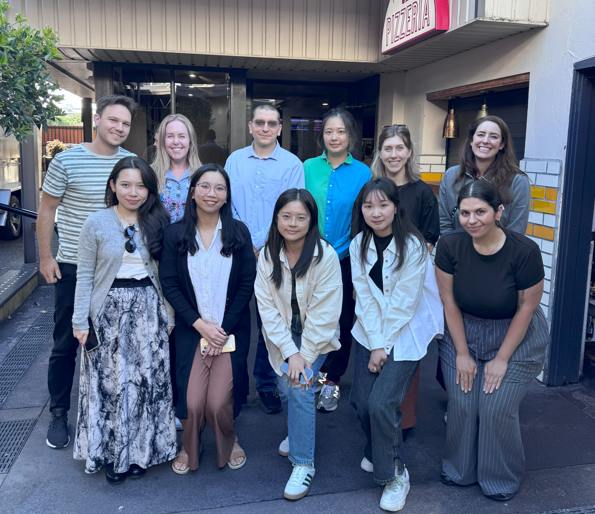
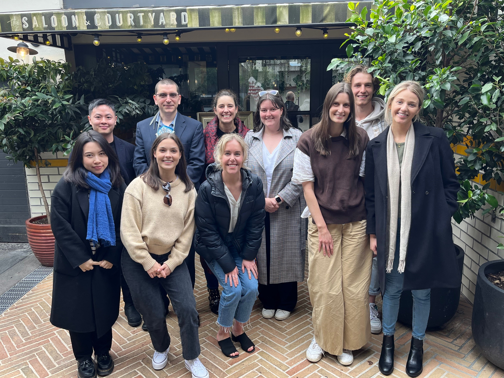
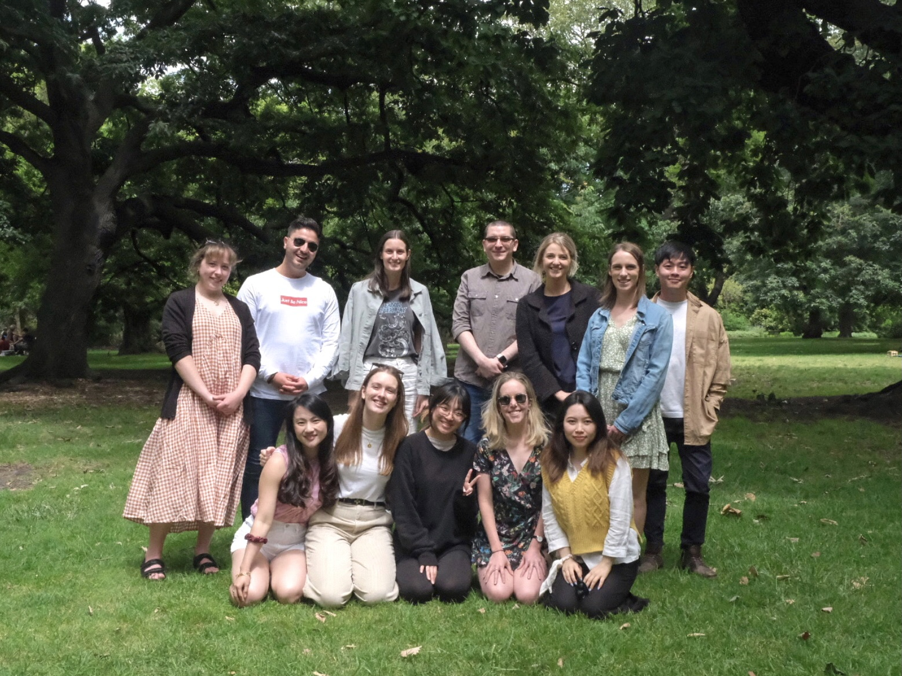
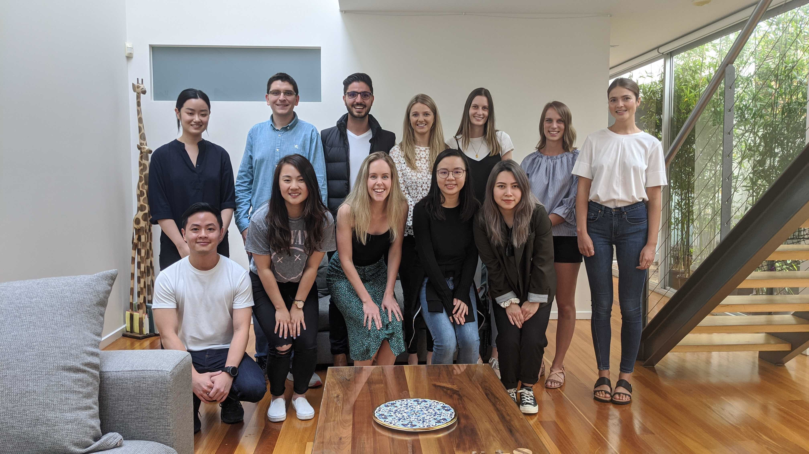
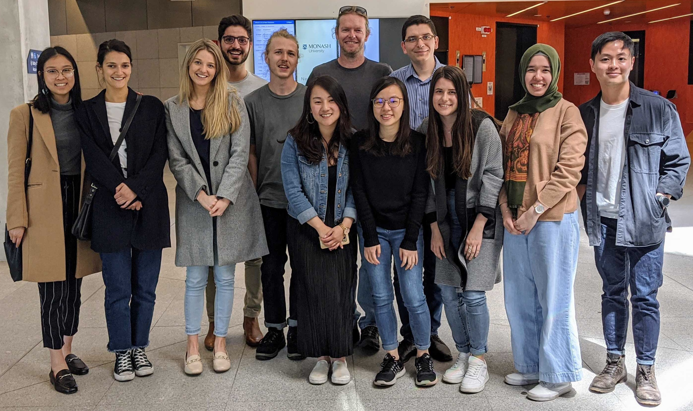

```{r}
#| include: false

## Team page ("Night and Day" design): navy hero with the computed lab counts
## and the group photos (a tabset of years) across the night/day line; current
## members (a tabset of roles drawn as pills; the lab head card first); alumni
## by year; and the "Want to join us?" navy card (#join, kept for old links)
## on the day background before the footer, which points to the Get involved
## page (join.qmd). Built from Pandoc
## markdown (fenced divs and spans) that the chunks below cat(); styles are in
## styles/bml.scss and styles/bml-team.scss. The page has no title (so no
## title banner): the hero's .bml-display is the page heading.

## load packages and setup
source("package_setup.R", echo = FALSE)

## Everyone in the People sheet except withdrawn roles (and Exclude rows, see
## readPeople()), one row per role, so someone who was e.g. an Honours then a
## PhD student appears twice. Names, roles and years only: no bios.
people <- readPeople()[Status != "Withdrew"]
people[, Name := paste(GivenName, FamilyName)]
people[, Initials := toupper(paste0(substr(trimws(GivenName), 1, 1),
                                    substr(trimws(FamilyName), 1, 1)))]
people[, Role := fcase(
  Type == "Postdoctoral", "Postdoctoral Fellow",
  Type == "Visiting PhD", "Visiting PhD Student",
  default = Type)]
people[, Doctoral := grepl("^(PhD|DPsych)", Type)]

## DOI link to a completed thesis, shown when present; the column may be
## missing (older workbook) or blank, so anything that isn't a URL is dropped.
## Only doctoral roles in the lab (the rows the thesis counts use) get a link:
## a visiting student's thesis from another university is not linked, so the
## links in an alumni row match its "N theses" tally.
if (!"ThesisLink" %in% names(people)) people[, ThesisLink := NA_character_]
people[, ThesisLink := fifelse(Doctoral & grepl("^https?://\\S+$", trimws(ThesisLink)),
                               trimws(ThesisLink), NA_character_)]

## role groups in display order, with the label of their filter pill
groups <- data.table(
  Group = c("Postdoctoral Fellows", "Staff", "Doctoral Candidates",
            "Masters Students", "Honours Students", "Visitors", "Other"),
  Tab = c("Postdocs", "Staff", "Doctoral", "Masters", "Honours", "Visitors", "Other"))
people[, Group := fcase(
  grepl("^Visiting", Type), "Visitors",
  Type == "Postdoctoral", "Postdoctoral Fellows",
  Type == "Staff", "Staff",
  Doctoral == TRUE, "Doctoral Candidates",
  grepl("^Masters", Type), "Masters Students",
  Type == "Honours", "Honours Students",
  default = "Other")]
people[, GroupNum := match(Group, groups$Group)]

current <- people[Status == "Current"][order(GroupNum, FamilyName, GivenName)]
past <- people[Status == "Completed"][order(-Ended, GroupNum, FamilyName, GivenName)]

## flag completed roles with no end year in the render log (not on the page)
if (past[is.na(Ended), .N] > 0) {
  cat("team.qmd: ", past[is.na(Ended), .N], " completed People rows have no Ended year; ",
      "they are listed in the alumni's final 'Other' row.\n", sep = "", file = stderr())
}

## hero counts: current members, completed doctoral theses (PhD and DPsych,
## not Visiting) and Honours graduates
counts <- labCounts()

## the lab head card's line, from the Positions sheet: current position, then
## the current honorary role(s), e.g. "Associate Professor, Monash University
## · Honorary Research Fellow, Peter MacCallum Cancer Centre"
positions <- as.data.table(read_excel(cvpath, sheet = "Positions"))[Ended == "Current"]
honorary <- positions[grepl("Honorary", Position),
                      ifelse(is.na(Info), Position, paste(Position, Info, sep = ", "))]
headLine <- paste(c(paste0(currentPosition(), ", Monash University"), honorary),
                  collapse = " \u00b7 ")

## ---- markdown pieces (all text through mdEscape(); no HTML, no CSS) ----

## "*" after the name when Joshua is (or was) the primary supervisor; screen
## readers hear the words instead of the symbol
star <- function(primary) {
  ifelse(!is.na(primary) & primary == 1,
         "[\\*]{.bml-star aria-hidden=\"true\" title=\"Primary supervisor: Dr Wiley\"}[, primary supervisor Dr Wiley]{.visually-hidden}",
         "")
}

## a current member's card: initials, name, role, year joined (on phones the
## card is a row and role and year share a line)
memberCard <- function(x) {
  sprintf('
::: {.g-col-12 .g-col-sm-6 .g-col-lg-3 .bml-card .bml-member}
[%s]{.bml-avatar aria-hidden="true"}

::: {.bml-member-text}
[%s%s]{.bml-member-name} [%s]{.bml-member-role} [Joined %d]{.bml-member-since}
:::
:::
', x$Initials, mdEscape(x$Name), star(x$Primary), mdEscape(x$Role), as.integer(x$Started))
}

## the lab head's navy card (first in every filter, as in the design); the
## whole card links to the CV page. The photo is shown small by CSS
## only (never resized).
## The line under the name states his position, so the name carries no "Dr"
## (the site's rule: "Dr Wiley" in general mentions, the official title
## wherever his role is stated).
labHeadCard <- function(lazy) {
  sprintf('
::: {.g-col-12 .g-col-lg-6 .bml-card .bml-night .bml-labhead}
{.bml-avatar-photo fig-alt="Portrait of Joshua F. Wiley"%s}

::: {.bml-labhead-text}
[Lab head]{.bml-eyebrow}

[[Joshua F. Wiley](cv.qmd){.stretched-link}]{.bml-title}

[%s]{.bml-labhead-line}
:::
:::
', if (lazy) ' loading="lazy"' else "", headLine)
}

## the cards of one filter tab
memberTab <- function(label, x, first) {
  cat("\n### ", label, "\n\n::: {.grid .bml-gap-sm .bml-members-grid}\n", sep = "")
  cat(labHeadCard(lazy = !first))
  for (i in seq_len(nrow(x))) cat(memberCard(x[i]))
  cat("\n:::\n")
}

## a thesis link; its accessible name says whose thesis it is
thesisLink <- function(url, name) {
  ifelse(is.na(url), "", sprintf(
    ' [thesis \u2197](%s){.bml-thesis aria-label="Thesis by %s"}',
    gsub(")", "%29", gsub("(", "%28", url, fixed = TRUE), fixed = TRUE),
    attrEscape(name)))
}

## one alumni row: the year (with "9 people · 5 theses" on phones), then
## everyone who completed a role that year: name (with the primary-supervisor
## star), role, thesis link. Someone who finished two roles in one year (e.g.
## a staff role and a PhD) is listed twice but counted once.
plural <- function(n, one, many) sprintf("%d %s", n, ifelse(n == 1, one, many))
alumniRow <- function(label, x, meta) {
  nTheses <- x[Doctoral == TRUE, .N]
  tally <- paste(c(plural(uniqueN(x$Name), "person", "people"),
                 if (nTheses > 0) plural(nTheses, "thesis", "theses")),
               collapse = " \u00b7 ")
  cat(sprintf('
::: {.bml-row}
::: {.bml-row-head}
[%s]{.bml-row-label} [%s]{.bml-row-sum}
:::

::: {.bml-alumni-names}
%s
:::
:::
', label, tally, paste(sprintf("[[%s%s]{.bml-alumni-name} [%s]{.bml-muted}%s]{.bml-alumnus}",
                        mdEscape(x$Name), star(x$Primary), meta, thesisLink(x$ThesisLink, x$Name)),
                collapse = "\n")))
}
```

::: {.column-screen .bml-band .bml-straddle .bml-hero .bml-team-hero}
::: {.grid .bml-gap-lg .align-items-end .bml-team-head}
::: {.g-col-12 .g-col-lg-6 .g-col-xl-7}
::: {.bml-display role="heading" aria-level="1"}
Meet the lab
:::
:::
::: {.g-col-12 .g-col-lg-6 .g-col-xl-5 .bml-statrow}
::: {.bml-stat}
[`r counts$current`]{.bml-stat-num} [current members]{.bml-stat-label}
:::
::: {.bml-stat}
[`r counts$theses`]{.bml-stat-num} [doctoral theses]{.bml-stat-label}
:::
::: {.bml-stat}
[`r counts$honours`]{.bml-stat-num} [Honours graduates]{.bml-stat-label}
:::
:::
:::

::: {.panel-tabset .bml-tabs .bml-tabs-sm .bml-tabs-below .bml-photos}
### 2024

{fig-alt="Group photo of the Behavioural Medicine Lab in 2024, standing outside a restaurant"}

### 2022

{fig-alt="Group photo of the Behavioural Medicine Lab in 2022, in a courtyard" loading="lazy"}

### 2021

{fig-alt="Group photo of the Behavioural Medicine Lab in 2021, on the grass in a park" loading="lazy"}

### 2020

{fig-alt="Group photo of the Behavioural Medicine Lab in 2020, in a living room" loading="lazy"}

### 2019

{fig-alt="Group photo of the Behavioural Medicine Lab in 2019, in a building foyer" loading="lazy"}
:::
:::

::: {.column-screen .bml-band .bml-members}
::: {.bml-members-head}
## Current members {#current-members}
:::

```{r}
#| echo: false
#| output: asis

## filter pills: All, then each role group that has someone in it
cat("\n::: {.panel-tabset .bml-tabs .bml-members-tabs}\n")
memberTab("All", current, first = TRUE)
for (g in intersect(groups$Group, current$Group)) {
  memberTab(groups[Group == g, Tab], current[Group == g], first = FALSE)
}
cat("\n:::\n")
```

[[\*]{.bml-star} Dr Wiley is the primary supervisor.]{.bml-meta .bml-members-note}
:::

::: {.column-screen .bml-band .bml-alumni}
::: {.grid .bml-gap-lg}
::: {.g-col-12 .g-col-lg-4 .bml-alumni-intro}
## Alumni {#alumni}

Everyone who has completed a role in the lab, by year. Doctoral theses are linked. [\*]{.bml-star} marks Dr Wiley as the primary supervisor.
:::
::: {.g-col-12 .g-col-lg-8 .bml-rows}
```{r}
#| echo: false
#| output: asis

## newest year first
for (y in unique(na.omit(past$Ended))) {
  x <- past[Ended == y]
  alumniRow(y, x, mdEscape(x$Role))
}

## completed roles with no end year in the spreadsheet (flagged in the render
## log above): a final row, with the year each role started
if (past[is.na(Ended), .N] > 0) {
  x <- past[is.na(Ended)]
  alumniRow("Other", x, sprintf("%s, from %d", mdEscape(x$Role), as.integer(x$Started)))
}
```
:::
:::
:::

::: {#join .column-screen .bml-band .bml-join}
::: {.bml-card .bml-night .bml-join-card}
::: {.grid .bml-gap-lg .align-items-center}
::: {.g-col-12 .g-col-lg-7 .bml-join-main}
## Want to join us? {#want-to-join-us}

We supervise Honours, Masters and PhD students, and host visiting students and researchers. We especially welcome people from groups under-represented in the health sciences.

[Study with us](join.qmd#study){.bml-btn}
:::
::: {.g-col-12 .g-col-lg-5 .bml-join-aside}
Before you get in touch, read about our [research themes](research.qmd) and the [values](ethics_values.qmd) we work by. Studies, lived experience roles and jobs are listed on our [Get involved](join.qmd) page.
:::
:::
:::
:::
